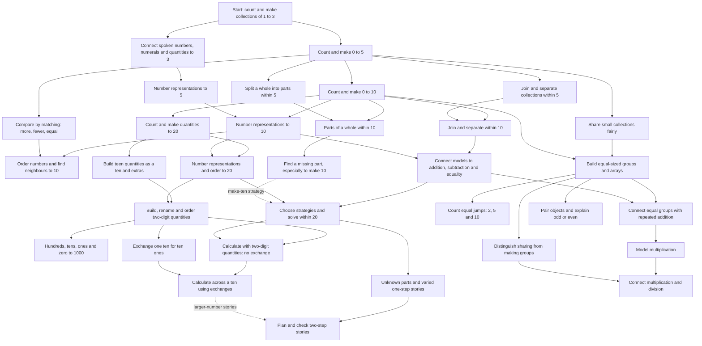
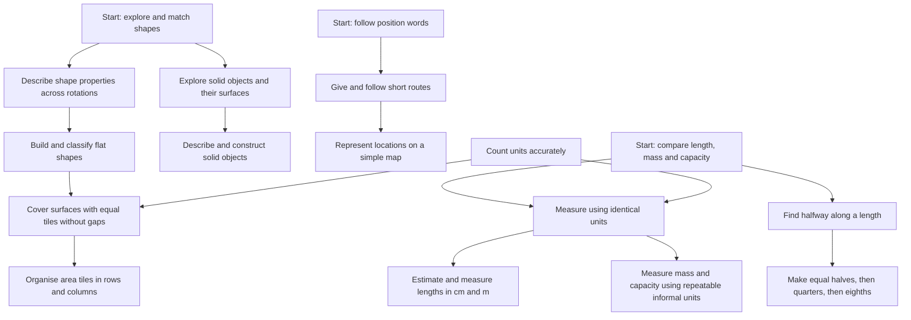
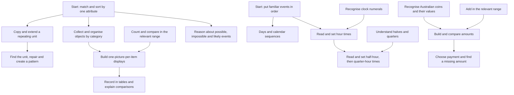

# Starwhisker learning progression: Kindergarten through Year 2

Design proposal, 28 October 2026. This is an original game progression informed by the linked references, not an IXL prerequisite graph or a validated assessment. The existing game is unchanged.

## Curriculum and progression

Use NSW Early Stage 1 and Stage 1 as the curriculum spine. Years 1 and 2 share Stage 1 outcomes; assign each child a position in each strand rather than one overall grade. IXL's year catalogues supply examples of scope and representations, not mandatory gates. Do not require completion of every catalogue exercise. Store source links and outcome codes separately from game skill IDs.

The diagrams below are proposed prerequisite relationships. Multiple incoming solid arrows mean AND. A node is a skill family: split it into individually assessed objectives before implementation. For example, joining and separating need separate records; success in joining must not hide difficulty with separating. Number ranges are also separately assessed. Dotted links are helpful connections rather than gates.

Six starting activities have no mathematical prerequisites: counting small collections, matching attributes, exploring shapes, following spatial directions, comparing physical quantities, and sequencing familiar events. A short interaction tutorial checks that the child can select/move objects; it never awards mathematical mastery.

### Number and operations



Important objective splits:

- Counting: stable count sequence; one count per object; final count gives the total; make a requested set; recognise zero; count rearranged/scattered sets. Reciting the sequence alone does not establish quantity understanding.
- Fast recognition of small quantities is a parallel objective, not a compulsory speed gate for counting. Use dot arrangements and ask how the child saw the groups.
- Neighbours: one more and one less separately; forward and backward sequences from varied starting points; ordering and ordinal position separately.
- Arithmetic: concrete model, picture, equation and story are separate evidence dimensions. Teach the meaning of equality as the same quantity on both sides.
- Strategies: counting on, doubles, near doubles and making ten are alternative routes. Do not require every strategy before allowing useful progress.
- Word problems: introduce oral stories alongside concrete learning. Later tests mix join, separate, compare and missing-part structures; never teach keyword rules such as “more always means add”.
- Place value: include 40 versus 4, 52 versus 25, 101 versus 110, and crossing 99/100. Assess representation and reasoning, not handwriting/spelling as a prerequisite for mathematics.
- Sharing: contrast “12 berries shared among 3 friends” with “12 berries, 3 per basket”. The unknown is different.

### Shape, space and measurement



M0 and M1 are separate objectives for each attribute; none gates the others. C refers to the number-strand counting objective for the range used. Fractions of lengths begin with physical folding and matching; a child need not master formal division first. Equal parts of collections and shapes can support learning but do not substitute for demonstrating fractions of a length.

### Patterns, data and everyday applications



Do not make colour discrimination necessary: pair colours with textures/shapes. Chance tasks ask children to reason from possible outcomes; a surprising random result is not an incorrect prediction. Money is an application branch and requires its own familiarity lesson.

## Teach and test through play

Every objective has a demonstration, a scaffolded attempt, independent variants and later retrieval. A new skin on the same numerical question is not enough variation.

| Skill family | Teach in the game | Independent evidence and useful variation |
| --- | --- | --- |
| Quantity | Give one snack to each creature; touch-count and say the final total | Make a requested set; count scattered items; rearrange without changing quantity; vary 0 and boundary values |
| Parts and wholes | Split berries between two baskets while keeping the whole visible | Create two different splits of the same total; find a hidden part; show that the whole stays unchanged |
| Addition/subtraction | Animate arrivals and departures; link actions to a picture and equation | Child constructs the scene and solution; vary unknown position and operation; include zero |
| Make ten | Fill a ten-place seed tray; show how many empty places remain | Different given amounts, unstructured collections and an oral story; construct the missing amount |
| Place value | Bundle ten sticks; exchange a bundle for loose sticks | Build and rename a quantity, compare it to a misleading neighbour, explain the role of zero |
| Groups and operations | Deal food fairly; arrange seats in equal rows | Build groups from an oral request; solve both sharing and grouping; explain what each number counts |
| Shape and position | Rotate puzzle pieces; follow a character's route | Select rotated/unusual examples, reject near-misses, construct a shape or give directions |
| Measurement | Align ends; place identical units end-to-end; demonstrate gaps causing bad measurements | Measure a new object, repair a flawed measurement, choose an appropriate unit; use a balance/pouring task for mass/capacity |
| Fractional lengths | Fold a ribbon, match parts, fold again | Create an equal partition of a new length; reject unequal partitions; find a quarter or eighth |
| Patterns | Highlight the repeating unit, then fade highlighting | Repair an internal gap; create a new pattern with the same structure using different objects |
| Data | Ask creatures a question and place one token per answer | Build a display from fresh data; answer “how many more?”; detect an incorrect display |
| Time and money | Move clock hands together; exchange coins while maintaining value | Set a spoken time; create an amount with different coins; avoid reliance on image position or coin size |

Mass/capacity need believable simulations or optional adult-observed physical tasks: static pictures alone cannot establish actual measurement competence. Record adult observations separately from automatically scored evidence.

## Teaching loop and evidence rules

1. **Discover:** offer 2–3 low-pressure probes near the child's estimated level. These choose a starting point; they do not establish mastery or automatically mark all ancestors mastered.
2. **Model:** one short narrated example with visible objects and a clear strategy.
3. **Guide:** 2–4 attempts; gradually remove pointing, grouping and answer cues.
4. **Practise independently:** fresh quantities/layouts; let the child choose suitable mathematical tools.
5. **Check later:** retrieve the skill after a delay and in a changed context.
6. **Repair:** use the observed error to select a smaller prerequisite lesson; then return to a fresh target task.

After two similar errors or visible repeated struggle, stop the test and switch to teaching. Offer an easier success, another strand or a break. Do not demand an endless correct-answer streak. Guided practice can be repeated, but it never becomes independent mastery evidence.

Keep accessibility support distinct from mathematical hints. Reading the prompt aloud, larger targets, keyboard input, or moving an object on the child's instruction need not invalidate evidence. Highlighting the answer or demonstrating the strategy does. Manipulatives are valid independent tools when the objective allows them; record mental fluency separately if it is the actual target.

### Proposed pilot mastery policy

These thresholds are starting product settings to evaluate with educators and children, not research-established proof. Report “secure on observed tasks”, never certainty about a child's ability.

| State | Evidence | Game action |
| --- | --- | --- |
| Ready | All required prerequisites are developing/secure, or diagnostic placement justifies a provisional entry | Offer the lesson |
| Learning | Demonstrations or supported attempts underway | Teach and vary practice |
| Developing | At least 4 of the most recent 5 fresh independent first responses correct, with 2 task formats | Offer successor teaching provisionally and schedule another check |
| Secure | At least 9 of the most recent 10 qualifying first responses correct, spanning 3 sessions on 3 different days; at least one check 7+ days after first independent success; 3 task formats, 2 contexts and 2 construction/transfer successes | Confirm mastery badge and normal successor access |
| Refresh due | Scheduled time has arrived; no new failure is implied | Offer a short retrieval opportunity |
| Revisit | At least 2 errors among 3 fresh review tasks, after checking for UI/access difficulties | Give focused support; keep earned story progress |

A qualifying response is a fresh first submission to an independent task. Record wrong responses as well as correct ones. A retry, immediately repeated fact, hinted response or demonstrated answer cannot count as an additional independent success. Tiny domains naturally repeat facts: spread these over sessions and vary the representation and reasoning demand. Maintain coverage tags so 9/10 on easy values does not imply mastery of an entire range.

Use the latest complete evidence window, not the child's best streak. Across that window, include every essential facet in the objective's coverage rubric. If 10 items cannot adequately cover a broad family, split it into smaller objectives rather than stretching the claim. Time elapsed is not evidence of failure, and review overdue never automatically revokes mastery.

Proposed retrieval schedule: next available session around 1, 3, 7, 14 and 30 days after learning. Missed days carry the review forward without penalties or backlogs. One failed review prompts another task; it does not erase learning. After a confirmed lapse, use a brief repair lesson and two later independent checks before restoring the secure state. Pilot both this rule and the initial threshold.

Short missions should usually contain one familiar success, one current learning objective and one useful review, with an optional challenge. Stop at a natural success or fatigue signal. The scheduler should choose due reviews, useful prerequisite repairs and child-selected ready nodes; balance strands so arithmetic does not crowd out spatial and measurement work.

## Fit to the existing game

- Keep `done` as story state. Supported completion still opens a bridge and earns kindness rewards. Never close a previously crossed bridge after a review error.
- `missing-10`: replace repeated 10-minus-6 encounters with a progression through small parts/wholes, then varied complements of ten. The current answer of four is one observation.
- `share-6`: begin with smaller even totals and two recipients, then vary totals and recipients. Assess equal distribution and use of the whole collection separately.
- `count-1`: start from numbers other than one, vary missing positions, then connect sequences to quantities. The current 1,2,3,4,? prompt cannot establish broad counting mastery.
- Use all regions for multiple levels and strands; a location should not force a child into one grade. Keep the visible next choices to roughly three missions.
- Current `Evidence` records completion, attempts and support. Add an attempt-level learning log before implementing mastery: unsuccessful first responses currently lack the detail needed for a trustworthy denominator.

Suggested future records:

```text
Skill: id, objective, numberRange, prerequisitesAll, helpfulConnections,
       outcomeCodes, sources, teachingVariants, assessmentRubric, policyVersion
Attempt: learnerId, skillId, itemId, generatorVersion, mathematicalSignature,
         sessionId, timestamp, firstResponseCorrect, submittedResponse,
         mode, representation, context, facetTags, hintLevel,
         mathematicalAssistance, accessibilitySupport, misconceptionTag
SkillState: status, evidenceIds, coverage, lastIndependentSuccess,
            nextReviewAt, provisionalPlacement, policyVersion
```

Persist dates across sessions and isolate each child's progress. Store enough evidence to explain a decision; the current global 200-record limit is insufficient for long-term multi-skill histories without durable per-skill summaries. Derive unlocks from explicit prerequisites, and validate IDs, cycles and unreachable nodes. Keep evidence policy versioned so a rule change can be explained.

Parent view example: “Making ten: secure on observed tasks. 9/10 independent first responses across 3 days, including a new context and a delayed check. Next review due.” Show the specific remaining facet when evidence is incomplete.

## Curriculum mapping and scope

Provisional outcome tags for review: number representation → MAE-RWN-01/02, MA1-RWN-01/02; parts and operations → MAE-CSQ-01/02, MA1-CSQ-01; grouping → MAE-FG-02, MA1-FG-01; repeating patterns → MAE-FG-01; direction/length/fractional length → GM outcomes; shapes/area → 2DS outcomes; solids/capacity → 3DS outcomes; mass/time → NSM outcomes; displays and interpretation → DATA outcomes; chance → MA1-CHAN-01. Working mathematically, MAO-WM-01, is assessed through construction, strategy choice and explanation across the graph. These are family tags, not claims that a single game task satisfies a whole outcome.

First implementation slice: small quantity objectives, parts/wholes within five, fair sharing and repeating patterns; then complements of ten and representation to twenty; then extend each parallel strand. Build independent variant generation and evidence tracking before broadening to larger arithmetic. Review the full NSW content points when turning this family map into the production catalogue; it is not an exhaustive mapping of every IXL exercise.

## Sources and their role

- [IXL Foundation](https://au.ixl.com/maths/foundation), [Year 1](https://au.ixl.com/maths/year-1), [Year 2](https://au.ixl.com/maths/year-2): inspected topic catalogues. Overlap across years supports reusing objectives with different ranges and evidence, rather than duplicate grade-specific mastery records.
- [IXL NSW Year 1 skill plan](https://au.ixl.com/maths/skill-plans/new-south-wales-nsw-curriculum-year-1): inspected the rendered plan and its mapping of activities to NSW outcome codes. An activity listing is not a dependency specification or complete evidence of outcome coverage.
- [NESA outcomes](https://curriculum.nsw.edu.au/learning-areas/mathematics/mathematics-k-10-2022/outcomes) and [course overview](https://curriculum.nsw.edu.au/learning-areas/mathematics/mathematics-k-10-2022/overview?active=1001): curriculum authority and flexible progression across stage content. Consult for the precise wording and scope of outcomes.
- [IES: Teaching Math to Young Children](https://ies.ed.gov/ncee/wwc/PracticeGuide/18): developmental progressions and monitoring to inform teaching. The guide rates evidence separately for its recommendations; it does not validate this graph or scoring policy.
- [AERO: Spacing and retrieval practice](https://www.edresearch.edu.au/guides-resources/practice-guides/spacing-and-retrieval-practice-guide-full-publication) and [Vary practice](https://www.edresearch.edu.au/guides-resources/practice-guides/vary-practice): basis for delayed retrieval and varied application. Exact intervals, item counts and thresholds above are design choices to pilot.
